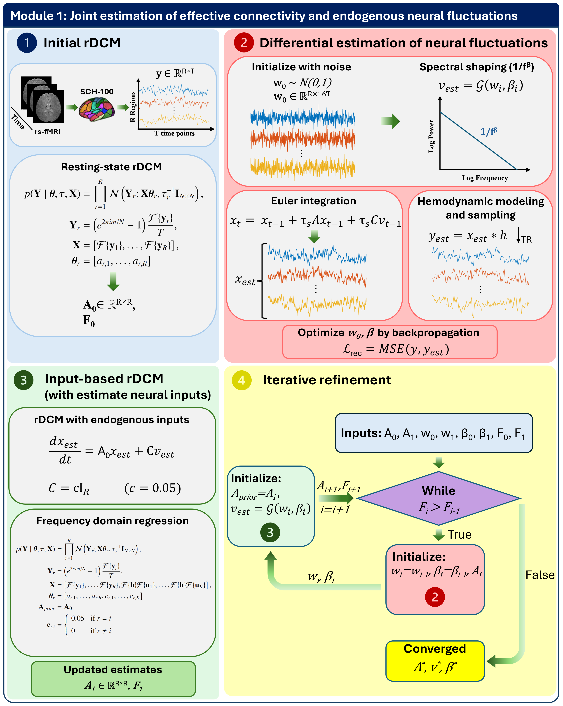
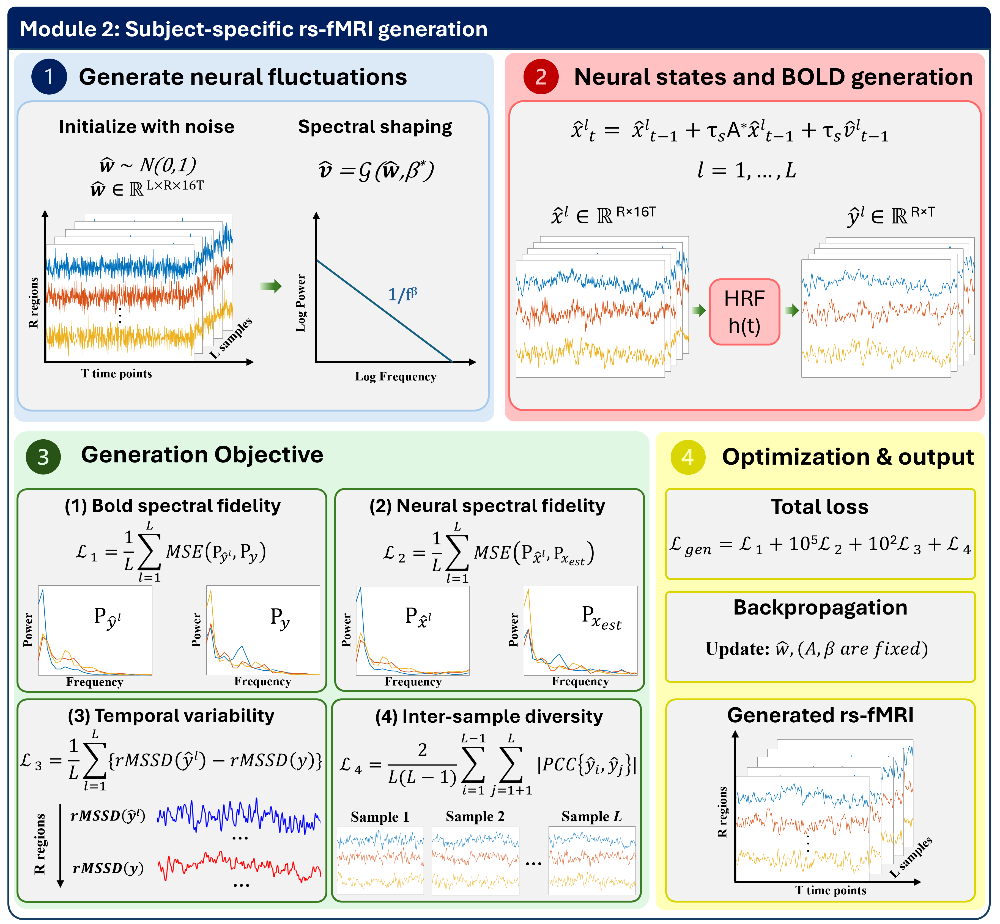

<div align="center">

# BOLDGEN

**Biophysically grounded, subject-specific generation and augmentation of resting-state fMRI time series**

[](https://www.python.org/)
[](https://pytorch.org/)

</div>

## Overview

BOLDGEN combines regression Dynamic Causal Modeling (rDCM) with differentiable estimation of endogenous neural fluctuations to generate alternative BOLD time-series realizations for an individual. Unlike models trained to sample from a population-wide distribution, the approach conditions each generation on estimates derived from an observed rs-fMRI time series.

The workflow has two principal modules:

1. **Subject-specific estimation:** estimate effective connectivity (EC) using rDCM, optimize latent neural fluctuations through a differentiable neural/hemodynamic forward model, and refine EC using the inferred inputs.
2. **Subject-specific generation:** synthesize new neural fluctuations and propagate them through the inferred system and hemodynamic response to obtain augmented BOLD time series while optimizing temporal and spectral properties and sample diversity.

### Module 1 — Estimate EC and endogenous neural fluctuations



### Module 2 — Generate subject-specific rs-fMRI time series



## Repository guide

| Files | Purpose |
| --- | --- |
| `BOLDGEN_module1_HCP.py`, `BOLDGEN_module1_ABIDE.py` | Module 1 estimation on HCP and ABIDE data. |
| `BOLDGEN_module2_HCP.py`, `BOLDGEN_module2_ABIDE.py` | Module 2 generation of augmented time series. |
| `rdcm.py`, `reverse_dcm.py`, `utils.py`, `utils1.py` | rDCM, forward-model, and supporting numerical utilities. |
| `dcm_euler_integration_extension.cpp` | C++ / PyTorch extension for Euler integration. |
| `contrastive_learning_experiment.py`, `gender_classification.py`, `prepare_for_rex.py` | Contrastive pretraining, linear downstream classification, and ReX preparation. |
| `MSM_experiment.py` | Masked sequence modeling with Transformer encoder–decoders. |
| `ASD_classification_ASD_DiagNet.py`, `ASD_classification_BolT.py`, `ASD_classification_VarCoNet*.py` | ASD classification experiments. |
| `TVFC_HCP.py`, `TVFC_ABIDEI.py`, `context_fidelity*.py`, `subject_fingerprinting.py` | Brain-state, distributional-fidelity, and subject-fingerprinting evaluations. |
| `plot_*.py`, `rex_plots*.R`, `paper_plots/` | Plots, ReX visualizations, and figures used in the manuscript. |
| `prepare_*.py`, `parcellate_*.py`, `gather_data.py`, `unzip_delete_HCP.py` | Dataset preprocessing and preparation utilities. |

## Installation and external requirements

The scripts were developed with Python **3.11** and **PyTorch**; GPU acceleration is used throughout the experiments. The repository does not currently provide a pinned, end-to-end environment specification. Install a compatible PyTorch build for your device, then install the scientific packages required by the scripts you plan to run (including NumPy, SciPy, scikit-learn, pandas, matplotlib, tqdm and, for particular scripts, Nilearn, `kmeans-pytorch`, `pl-bolts`, and `seaborn`). ReX plots require R with `ReX`, `data.table`, and `ggplot2`.

Several evaluation/baseline scripts also import code from **external projects** (for example, CR-VAE, Diffusion-TS/TS2Vec, and VarCoNet-related components). These must be installed or made available on the Python import path. Some existing scripts contain historical absolute paths for external imports; inspect these before running them on another machine. No dataset or pretrained-model download is bundled here.

## Data and workflow

The experiments use parcellated rs-fMRI time series from the **Human Connectome Project (HCP)** and **ABIDE I/II**. Respect each dataset's access requirements and prepare the subject-level data before running the generative modules. Sequence lengths, temporal resolutions, and atlas conventions must match the selected experimental configuration.

A typical workflow is:

1. **Prepare and parcellate** data using the relevant `prepare_*.py` and `parcellate_*.py` scripts.
2. **Estimate subject-specific dynamics** using the HCP or ABIDE Module 1 entry point.
3. **Generate augmented time series** with the corresponding Module 2 entry point.
4. **Evaluate generation quality** using the Context-FID, brain-state, and fingerprinting scripts.
5. **Evaluate downstream utility** using contrastive learning / gender classification, masked sequence modeling, or ASD classification.
6. **Generate figures** with the `plot_*.py` and ReX scripts.

### Example commands

For scripts with command-line entry points, run `python SCRIPT.py --help` to inspect the available options. Paths are **required** rather than tied to the original author's filesystem; the existing numeric and categorical experiment settings remain the defaults.

```bash
# HCP estimation (Module 1)
python BOLDGEN_module1_HCP.py \
  --data_path /path/to/HCP_data \
  --save_path /path/to/results \
  --case full_subsampled

# HCP generation (Module 2)
python BOLDGEN_module2_HCP.py \
  --data_path /path/to/HCP_data \
  --save_path /path/to/results \
  --case full_subsampled

# Example: compare temporal functional connectivity / brain states
python TVFC_HCP.py \
  --path_data /path/to/HCP_data \
  --path_save /path/to/results \
  --path_augmented_boldgen /path/to/BOLDGEN_augmented \
  --path_augmented_crvae /path/to/CR-VAE_augmented \
  --path_augmented_timevae /path/to/TimeVAE_generated \
  --path_augmented_timegan /path/to/TimeGAN_generated \
  --path_augmented_t2idiff /path/to/T2I-Diff_generated \
  --path_augmented_dsfm /path/to/DSFM_generated
```

Repeat experiments with other HCP configurations as required: `full_original`, `full_subsampled`, `half_original`, and `half_subsampled`. In scripts exposing `--device`, choose a suitable available PyTorch device (for example, `cuda:0` or `cpu`, subject to the script's implementation).

> **Reproducibility note:** Source files retain their original experimental computations, default numerical settings, and data layout assumptions. Paths and external imports must be configured for your environment; supplying a path alone does not install external baselines or data.

## Evaluation tasks

- **Context fidelity:** compares generated and empirical time-series distributions through TS2Vec representations and Context-FID.
- **Brain states:** compares recurring functional-connectivity patterns estimated from sliding windows and K-means clustering.
- **Subject fingerprinting:** checks preservation of individual-specific functional-connectivity signatures.
- **Contrastive learning:** assesses positive views generated from subject-specific augmented realizations; downstream performance is measured with gender classification.
- **Masked sequence modeling (MSM):** trains Transformer encoder–decoders on synthetic data and evaluates reconstruction on empirical signals.
- **ASD classification:** evaluates augmented training data with ASD-DiagNet, BolT, and VarCoNet using ABIDE I/II.

## Citation

If you use this repository, please cite the accompanying BOLDGEN manuscript when its bibliographic information becomes available, and cite the original rDCM and dataset publications as appropriate.

## License

This project is licensed under the GNU General Public License v3.0 (GPL-3.0). See the [LICENSE](LICENSE) file for details.

Third-party components remain subject to their respective copyright notices and license terms.
